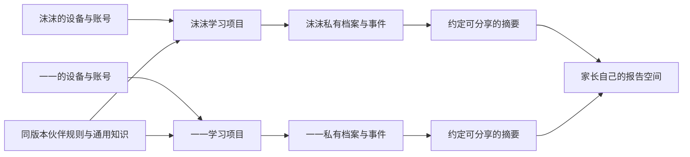

# 技术路线 v2：双账号 WorkBuddy 先行，可迁移的伙伴内核

日期：2026-10-26。状态：技术建议，未部署或实测。本轮不以旧 HANDOFF 中的“已定稿/开始赛马”替代家长最新的“先讨论功能再推进”。

## 1. 结论与理由

采用家长最新提出的 WorkBuddy 双账号先行：两位孩子分别在已有 Mac / Windows 电脑使用自己的账号和学习项目，复用平台的图片、语音入口，先验证伙伴互动是否可用。独立网页保留为需要更强界面、身份、流程与数据控制时的后续路线。

自建网页提供更多可设计的控制点；成熟技术栈本身不等于应用已稳定安全。两人家庭用量虽然小，仍需处理登录、权限、持久存储、备份、浏览器兼容、模型失败、图片与语音等。现阶段不必为验证教学体验先建设完整后台。

WorkBuddy 路线也有前提：实际输入路径可用、跨新任务能续接正确档案、两账号不串用私有信息、工具权限可收敛、孩子能在可接受时间得到帮助。验证不通过时应调整路线，不能因为配置已写好而持续迁就不合适的平台。

## 2. 已核实的平台事实与尚需实测的部分

| 项目 | 官方事实 | 应如何使用这条事实 |
| --- | --- | --- |
| App图片与语音 | [发起任务](https://www.codebuddy.cn/docs/workbuddyapp/features/Create-Task)明确麦克风录音转文字；[附件说明](https://www.codebuddy.cn/docs/workbuddyapp/features/Attachments-and-Skills)有拍照/相册，图片理解需视觉模型 | 能复用原生输入，但不能推出电脑端同样顺手；必须测试图片加语音在同一道题续接 |
| App连接电脑 | [多端协同](https://www.workbuddy.cn/docs/workbuddyapp/features/Multidevice)要求电脑开许可、双端同账号且联网，远程配置以电脑端为准；[概述](https://www.codebuddy.cn/docs/workbuddyapp/Overview)另区分云端执行 | 云端不会因此自动得到本机项目与文件；电脑睡眠/离线时不能保证本机任务运行，实际登录组合要核对 |
| 小程序 | [概述](https://www.codebuddy.cn/docs/workbuddymini/quick-start/Overview)写明文字、语音、图片、文件；云上与本机两种执行方式，本机要求两端同微信账号 | 作为可选入口单独测试，不能假定与App、Mac、Windows行为完全相同 |
| 项目与 Skills | [项目文档](https://www.codebuddy.cn/docs/workbuddy/From-Beginner-to-Expert-Guide/Function-Description/Project)支持项目常驻指令、专家和技能；代码开发模式读取 `.codebuddy/` 等项目配置并与用户配置合并 | 项目规则与技能的适配按实际模式确认，不依赖“模型一定会触发某个 Skill”来保证核心行为 |
| 记忆 | [更新日志](https://www.workbuddy.cn/docs/workbuddy/Changelog)记载 Working Memory 按工作区；[记忆说明](https://www.workbuddy.cn/docs/workbuddy/From-Beginner-to-Expert-Guide/Function-Description/Memory)描述自动个人记忆 | 账号分开降低同账号个人画像混用；仍测试项目、会话、资料、文件和跨端记忆，不能只测一次昵称 |
| 权限 | [默认权限与安全沙箱](https://www.workbuddy.cn/docs/workbuddy/From-Beginner-to-Expert-Guide/Function-Description/Permission-Modes)有默认/完全访问及路径、工具管控；部分设置为客户端全局范围 | 孩子环境只接必要资料和能力。能否防止孩子改变设置，需要实测，不宣称有现成的家长锁 |
| 价格 | [官方定价](https://www.workbuddy.cn/docs/workbuddy/Pricing)是后续核价来源 | 不把旧稿的积分、月费或 Token 换算当已确认预算；试用时记录实际用量 |

文档核验不能替代登录与实际设备验收。国内客户端的注册、未成年人及监护安排以届时实际条款核实，不用国际版条款或“已有手机号”直接推出可注册。

## 3. 先行方案的结构

通用规则可同版本复制；个人档案不放在全局共享技能正文。共有书架只保存书目与家中可用性，个人阅读状态分别存放。家长原始观察、成绩担忧和两人的私有资料不作为孩子项目的公共知识库。

### 统一内核与局部能力

计划保留一套常驻伙伴约定，再按场景调用作业、阅读、探索和普通交流的方法。另有学习证据记录与家长摘要能力。形式上可以继续使用现有六个 Skill 的目录类别，但需要依本稿改写，不能直接把旧版视为已验收成品。

首轮交付切片以[主提案§11](PROPOSAL.md#11-试用与继续条件)为准：四种意图保留基本回应；少量书目、愿望单和家长汇总可人工维持；全量书库、定时触达、自动汇总和定制界面后置。下列数据概念用于防止混用，不代表本轮须开发十套服务或把所有字段都收集齐。

常驻约定包括身份诚实、尊重、不代做、不贴标签、记录透明、专注时不主动发散。场景流程不能覆盖这些约定。Skills 是方法模块，不是孩子账号或权限系统，也无需让孩子输入 Skill 名称。

能力放置也要分开：四个场景方法和最小记录只接各孩子自己的受限资料；`parent-review`放在家长自己的空间，只读约定导出的摘要。不能为了“六个Skill齐全”把家长报告、另一孩子目录或家长私有观察一起挂到孩子项目。

### 输入的真实操作路径

- 电脑上：测试现有图片上传、拖入题目图片和实际可用的语音输入；摄像头能拍到不代表手写题能看清。
- 手机/App/小程序辅助：优先验证手机拍题进入对应电脑的实际路径；家中已有手机号不等于已有可用手机或拍摄设备，首次设备与登录安排由成人完成。确认对应孩子自己的题目和配置能在所选执行环境正确续接；不把家长手机上一次成功当作两位孩子都已可用。
- 语音只用于表达问题，保留文本修改/确认。它与本期排除的口语跟读、发音评分是两件事。
- 输入失败时保留重拍、改字、口述或手输的路径；不要让一次误识别污染长期掌握记录。

## 4. 数据：先能迁移，再谈复杂系统

先行阶段可以使用受限目录中的结构化小文件，但“模型说已记下”不代表落盘成功；每次记录应可核验、可更正。记录失败不阻断孩子继续，状态和失败应能被家长发现，重试不重复计数。

建议的数据概念：

| 类型 | 用途与边界 |
| --- | --- |
| `child_profile` | 稳定内部 ID、昵称、年级、教材；每条兴趣有 parent/child 来源、确认和更新时间 |
| `session_state` | 当前作业/阅读/探索/交流、具体任务、暂停点；不能用新会话 ID 代替孩子 ID |
| `learning_event` | 当前题/技能、孩子尝试、帮助方式、实际结果与来源；不靠普通聊天推断学科能力 |
| `memory_item` | 孩子愿意保留的兴趣、作品、阅读发现；支持查看、更正、忘记与到期 |
| `book_edition` | 标题、作者、版本/ISBN、杂志期号、资料来源；事实与模型推测分开 |
| `household_holding` | 家里是否有、在哪里、是否已到家；与阅读完成状态分开 |
| `child_book_state` | 每个孩子自己的想读、试读、在读、暂放、重读、读完，以及自报来源和可选阅读位置 |
| `book_request` | 想买、家长评估、下单、到家；不自动购买，不以购书为成效 |
| `followup_preference` | 是否愿意下次提起、适合场景、延后/停止；不默认创建推送任务 |
| `parent_report` | 引用事实事件 ID、样本范围、待验证点与家庭支持建议；导出 Markdown |

旧 `schemas/` 尚不满足这些概念，具体不一致列于 Kimi 审视。后续实现时先版本化 schema 和迁移规则，再写入新数据。本轮不修改旧 schema 来冒充已落地。

新增 `library/bookshelf.json` 的39条候选目录按[书架复核](research/bookshelf-review.md)迁移：历史 `unread` 不代表每人未读，个人状态从未知开始；`owner` 保留来源，不能据此限制另一孩子；套装/系列与单册版本分层；`transition_level` 不作为能力等级，`interest_hook` 不作为运行指令。先选少量核对项即可陪读。

普通交流可不产生学习事件。对“孩子说读完”只能记自报；对“自己做对”需要知道当时是否得到提示。没有独立尝试，不能自动写“掌握/延迟迁移”。

AI错讲/误识别被发现后，相关事件先失效或待核实，停止派生学情结论；保留不含多余私人内容的更正依据与关联，重算未分享摘要，已导出报告提供版本更正。备份恢复也须保留已生效的更正/撤回，不能用旧副本把已删除记忆带回来。

### 家长汇总

先采用透明、可检查的摘要导出：两个孩子各输出约定分享的事实摘要，家长在自己的空间汇总并保存 Markdown。不要把两孩子和家长的全部目录放进同一个可读项目来方便汇总。

能否由 WorkBuddy 自动完成跨账号汇总、长期书架状态同步和定时报告，尚未实测。最初可以由家长手动导入导出；这类内部维护不可强加给孩子。若连日常续接都需反复手工搬运，触发路线重评。

## 5. 哪些能强制，哪些只能降低风险

| 控制点 | WorkBuddy 先行 | 自建网页 |
| --- | --- | --- |
| 账号、目录、资料读取 | 依平台和实际权限配置验证 | 可由服务端身份逐请求授权；仍需测试 |
| 当前场景允许哪些工具 | 取决于平台是否提供足够细的配置 | 可由状态机强制工具白名单 |
| 家长与孩子的页面/数据范围 | 不能把提示词当隔离措施 | 可设计分开的角色与数据访问层 |
| 不代做、事实正确、不跑题、理解情绪 | 规则+流程+样例评测，不能保证百分百 | 同样需要规则、流程与评测；系统提示词或二次模型不构成绝对保证 |
| 数据是否全部本地处理 | 文件放本地不能推出推理本地 | 数据自存也仍会向所选 API 发送必要内容；依服务商政策确定处理范围 |

### 儿童开用前的证据表

配置阶段每个实际账号、设备和执行模式分别记录：官方文档出处、成人实测日期/版本、证据、状态和处理决定。状态区分“有官方说明”“成人实测通过”“未通过”“未核实”；前者不等于通过。本轮以下全部尚未实测。

| 判定项 | 最低可接受证据 | 未知或失败时 |
| --- | --- | --- |
| 实际注册与监护安排 | 核对国内实际入口的条款版本、日期和适用安排 | 不预设允许/禁止，不标为可直接给孩子使用 |
| 纸题与语音链路 | 两端分别跑通拍/传图、口头指认、纠错、继续同题 | 改路径并重测；人工替代也要实际跑通 |
| 身份、规则与资料范围 | 新会话/换端加载对人；A独有虚构信息在B及其导出中不可得，孩子不能读家长目录 | 停止相关儿童入口，先修隔离或改路线 |
| 必要工具与权限 | 仅接必要资料/能力，实际验证全局配置影响 | 不让孩子开完全访问补缺口；不能满足则改入口 |
| 记忆、更正与报告 | 存→改→新会话→删→摘要核对；明确平台历史边界及家庭是否接受 | 停用不可信记录/分享链，不能承诺已完成 |
| 中断、恢复与导出 | 虚构数据中断一次，恢复最后确认状态且不重计；最小迁移包可读且对人 | 修复后重测，不以“文件还在”代替恢复成功 |

人工维持的书架与周报可以先用，但不能人工绕过关键身份/权限要求。实际平台无法做到所需可见性时，应收缩记录范围或迁移，不能以家庭约定冒充技术限制。

### WorkBuddy阶段就要可恢复

由成人保存可迁移最小包：伙伴规则/模型配置版本、有效个人事实及来源、当前任务暂停点、所用书目和各人状态、约定可分享摘要及依据、更正/撤回状态。媒体、平台历史和自动记忆若不能导出，明确列出，不承诺完整恢复。

用虚构包完成一次导出、隔离保存、恢复核对；恢复只采用最后确认有效的数据，失败不说已记住/已完成。以后迁移网页时，先用虚构包验证身份、权限和更正/删除效果，再迁移实际最小数据。不因路线变更重新激活已撤回信息。

## 6. 转入网页的明确条件

出现任一情形即可重评，而不是无期限修补平台：

1. 实际拍题/语音路径繁琐、识别确认难用，孩子持续绕回原工具。
2. 账号与资料范围无法满足隔离或家长权限需求。
3. 新会话/换端后经常丢失伙伴状态、书架或个人档案。
4. 通用 Agent 的权限、执行过程和配置入口持续干扰孩子；关键规则无法稳定生效。
5. 孩子需要固定的帮助选项、可操作图示、书架与阅读接续界面，而原生平台无法提供合适体验。
6. 实际调用成本、网络或模型可用性不能满足家庭使用。

关键隔离或权限失败时先停止受影响入口再重评，无需等孩子多次遇到损失。体验繁琐等问题则看每个孩子的具体反馈，不能仅因她不用就判其动机不足。

其他候选如腾讯云ADP或Dify可作为后续搭建时再比较的后端工具，不作为本轮多加一层中间平台的理由。它们也不自动交付孩子的拍照入口、登录授权和伙伴体验，相关历史调研保留作候选。购买专用学习机则是另一种产品选择；本轮主要借鉴其交互机制，不据营销功能表建议家长重新购买硬件。

## 7. 网页备用架构建议

若触发迁移，优先“一个全栈应用 + 一个持久数据库 + 正式模型 API”的小型架构。建议候选是 Next.js/TypeScript 与 PostgreSQL，减少独立前后端服务数量；若接手团队已有成熟 FastAPI 能力，也可保留 React+FastAPI，必须写出选择原因。具体版本在开工时按受支持稳定版锁定，不把当前文档当依赖锁文件。

服务端从已验证会话得到孩子身份，在每次数据操作校验，而不是相信浏览器传来的 `child_id`；家长另有角色。Next.js [官方身份与授权指南](https://nextjs.org/docs/app/guides/authentication)要求在靠近数据的层面落实授权。PostgreSQL [行级安全文档](https://www.postgresql.org/docs/18/ddl-rowsecurity.html)还明确表所有者/超级用户可能绕过策略，不能“用了 RLS 就安全”。

数据库负责并发、约束、更正、持久化；JSONL/Markdown 用于可移植导出，不以分文件取代所有身份授权。图片/语音放私有对象存储，链接短期授权，设置保存与删除规则；密钥仅在服务端。模型供应商通过适配层更换，能力与条款按正式接口核实。

长期部署优先选择有持续运行、持久存储、HTTPS、备份和恢复能力的环境；家用笔记本睡眠/关机不能作为全天可用的保证。不立即承诺工期、API 月费或免维护。用虚构数据演练一次备份恢复、模型超时、额度用尽、上传中断和跨账号访问，再邀请孩子试用。

不需要本阶段建设运行时多代理、自治电脑操作或大型向量库。教育原则以明确规则和有来源的策略目录呈现，原始课程检索只作资料，不让其中的文字充当系统指令。

## 8. 模型订阅的待办

家长尚未指定可用的正式 API 服务；这不阻碍 WorkBuddy 先行，网页版接入时再确认。

不能把“聊天会员/编程套餐”自动当通用模型 API。OpenAI [计费说明](https://help.openai.com/en/articles/9039756-managing-billing-for-chatgpt-and-the-api-platform)说明 ChatGPT 与 API 分开计费；Kimi [API 常见问题](https://www.kimi.com/help/kimi-api/api-troubleshooting)区分会员、Code 与开放平台，且 [Code 概览](https://www.kimi.com/help/kimi-code/membership-guide)将自己的产品集成指向开放平台。具体按家长实际套餐核对，不通过伪装客户端或复用登录凭据接入。

相关：[提案](PROPOSAL.md)、[Kimi审视](KIMI-REVIEW.md)、[交接](DEVELOPMENT-HANDOFF.md)。
